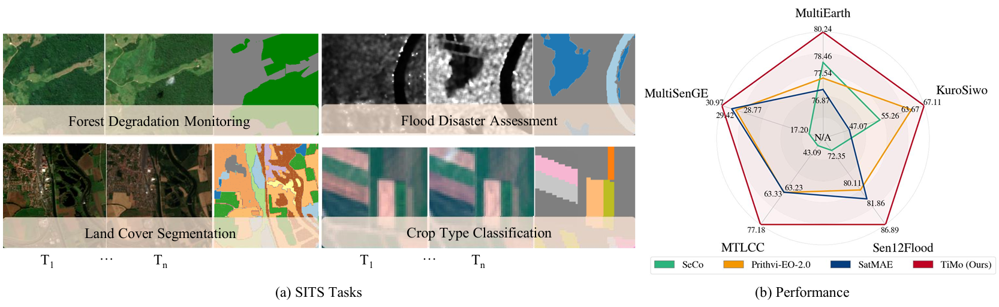

<p align="center">

  <h2 align="center"><strong>TiMo: Spatiotemporal Foundation Model for Satellite Image Time Series</strong></h2>

<div align="center">
<h5>
<em>Xiaolei Qin<sup>1 *</sup>, Di Wang<sup>1,2 *</sup>, Jing Zhang<sup>1 †</sup>, Fengxiang Wang<sup>3 </sup>, Xin Su<sup>1</sup>, Bo Du<sup>1,2</sup>, Liangpei Zhang<sup>1</sup></em>
    <br><br>
       	<sup>1</sup> Wuhan University, China,<br/>
        <sup>2</sup> Zhongguancun Academy, China,<br/> 
        <sup>3</sup> National University of Defense Technology, China<br/> 
</h5>
<h5>
<sup>∗</sup> Equal contribution, <sup>†</sup> Corresponding author
</h5>
</div>


<h5 align="center">
<a href="https://arxiv.org/pdf/2505.08723"> </a>
</h5>


# 🔥 Update
**2025.05.14**
- We uploaded our work on [arXiv](https://arxiv.org/pdf/2505.08723).

# 🌞 Introduction
TiMo is a novel hierarchical vision transformer foundation model tailored for SITS analysis. At its core, we introduce a spatiotemporal gyroscope attention mechanism that dynamically captures evolving multiscale patterns across both time and space. For pre-training, we curate MillionST, a large-scale dataset of one million images from 100,000 geographic locations, each captured across 10 temporal phases over five years, encompassing diverse geospatial changes and seasonal variations. Leveraging this dataset, we adapt masked image modeling to pre-train TiMo, enabling it to effectively learn and encode generalizable spatiotemporal representations. Extensive experiments across multiple spatiotemporal tasks—including deforestation monitoring, land cover segmentation, crop type classification, and flood detection—demonstrate TiMo's superiority over state-of-the-art methods.

<figure>
<div align="center">

</div>
<div align="center">
<figcaption align = "center"><b>Figure 1. TiMo surpasses existing spatiotemporal RSFMs, delivering superior performance across diverse SITS tasks, including forest monitoring, disaster assessment, ground-object recognition, and agricultural identification. 
 </b></figcaption>
</div>
</figure>

# Environment

The code was developed with PyTorch and common remote-sensing Python packages. A typical environment can be prepared with:

```bash
conda create -n timo python=3.8 -y
conda activate timo

pip install torch torchvision timm einops numpy pandas tqdm pillow opencv-python rasterio xarray numba mmengine
```

# Pre-trained Checkpoints

We provide pre-trained **[TiMo weights](https://drive.google.com/drive/folders/1AHTUS6WGL7yKlOm8XcQl0kt_XnSFw4b9?usp=sharing)**.

After downloading, use this checkpoint for downstream fine-tuning:

- segmentation: pass it with `--ft <PRETRAIN_CKPT>`;
- classification: pass it with `--finetune <PRETRAIN_CKPT>`.

# Segmentation Fine-tuning

The segmentation entry point is `segmentation/main_finetune.py`. Supported datasets are `MultiSenGE`, `MultiEarthDeforest`, `kurosiwo`, and `MTLCC`.

Below is an example using MultiSenGE. To run another segmentation dataset, change `--dataset`, the corresponding dataset path argument, and dataset-specific options such as `--img_size`, `--in_chans`, `--nb_classes`, `--ignore_label`, and `--lr`.

## Training Example

```bash
cd TiMo/segmentation

CUDA_VISIBLE_DEVICES=0 python main_finetune.py \
  --model TiMo \
  --backbone TiMo_base \
  --dataset MultiSenGE \
  --multisenge_path <MULTISENGE_ROOT> \
  --epochs 30 \
  --workers 4 \
  --ft <PRETRAIN_CKPT> \
  --output_dir ../outputs/MultiSenGE/TiMo_base \
  --log_dir ../logs/MultiSenGE/TiMo_base
```

## Evaluation Example

```bash
CUDA_VISIBLE_DEVICES=0 python main_finetune.py \
  --model TiMo \
  --backbone TiMo_base \
  --dataset MultiSenGE \
  --multisenge_path <MULTISENGE_ROOT> \
  --epochs 30 \
  --workers 4 \
  --eval \
  --resume <FINETUNED_CKPT> \
  --output_dir ../outputs/MultiSenGE/TiMo_base \
  --log_dir ../logs/MultiSenGE/TiMo_base
```

## Dataset Options

| Dataset | Path argument | Common settings |
| --- | --- | --- |
| `MultiSenGE` | `--multisenge_path <MULTISENGE_ROOT>` | `--img_size 256 --in_chans 10 --nb_classes 14` |
| `MultiEarthDeforest` | `--multiearth_path <MULTIEARTH_DEFOREST_ROOT>` | `--img_size 256 --in_chans 3 --nb_classes 2` |
| `kurosiwo` | `--kurosiwo_path <KUROSIWO_ROOT>` | `--img_size 224 --in_chans 2 --nb_classes 4 --ignore_label 3 --lr 1e-3` |
| `MTLCC` | `--mtlcc_path <MTLCC_ROOT>` | `--img_size 48 --in_chans 13 --nb_classes 18 --lr 1e-2` |

# Classification Fine-tuning

The classification entry point is `classification/main_finetune.py`.

## SEN12-FLOOD

```bash
cd TiMo/classification

CUDA_VISIBLE_DEVICES=0 python main_finetune.py \
  --model_type TiMo \
  --model TiMo_base \
  --dataset Sen12Flood \
  --data_path <SEN12FLOOD_ROOT> \
  --accum_iter 1 \
  --epochs 30 \
  --blr 5e-3 \
  --layer_decay 0.75 \
  --weight_decay 0.05 \
  --drop_path 0.2 \
  --batch_size 2 \
  --finetune <PRETRAIN_CKPT> \
  --num_workers 8 \
  --nb_classes 2 \
  --in_chans 3 \
  --warmup_epochs 0 \
  --output_dir ../outputs/Sen12Flood/TiMo_base \
  --log_dir ../logs/Sen12Flood/TiMo_base
```

Evaluation:

```bash
CUDA_VISIBLE_DEVICES=0 python main_finetune.py \
  --model_type TiMo \
  --model TiMo_base \
  --dataset Sen12Flood \
  --data_path <SEN12FLOOD_ROOT> \
  --accum_iter 1 \
  --epochs 30 \
  --blr 5e-3 \
  --layer_decay 0.75 \
  --weight_decay 0.05 \
  --drop_path 0.2 \
  --num_workers 8 \
  --nb_classes 2 \
  --in_chans 3 \
  --warmup_epochs 0 \
  --eval \
  --resume <FINETUNED_CKPT> \
  --output_dir ../outputs/Sen12Flood/TiMo_base \
  --log_dir ../logs/Sen12Flood/TiMo_base
```

# Notes

- `--ft` and `--finetune` initialize downstream models from a pre-trained TiMo checkpoint.
- `--resume` loads a fine-tuned checkpoint for resuming training or evaluation.
- The examples use TiMo-Base. To use other model sizes, set `--model TiMo_large` or `--model TiMo_huge` for pre-training/classification, and set `--backbone TiMo_large` or `--backbone TiMo_huge` for segmentation.


# MillionST Pre-training

The raw MillionST dataset is publicly available on **[Hugging Face](https://huggingface.co/datasets/Hillui/MillionST)**. Use `make_pretrain_data.py` to generate `.npy` files and a timestamp CSV for pre-training. Before running, update the hard-coded CSV output path in the script to your local path.

```bash
mkdir -p <MILLIONST_NPY_ROOT>
python make_pretrain_data.py \
  --root <MILLIONST_RAW_ROOT> \
  --save_path <MILLIONST_NPY_ROOT> \
  --make_npy_file \
  --make_ts_file
```
Format the generated CSV with columns `loc,t1,...,t10`, using our [released pre-training CSV](https://drive.google.com/file/d/1VTSBh0s_4aGx7SDK4am3WbnsCfiL5Exv/view?usp=drive_link) as a format reference. Ensure that `t1,...,t10` correspond to the observations stored in each `.npy` file in the same order. For pre-training, set `--data_path` to the NPY directory and `--csv_path` to the reformatted CSV.

## TiMo-Base Pre-training Example

```bash
cd TiMo/pretrain

CUDA_VISIBLE_DEVICES=0,1,2,3 python -m torch.distributed.launch \
  --nproc_per_node=4 \
  --use_env \
  --master_port=40002 \
  main_pretrain.py \
  --distributed True \
  --batch_size 16 \
  --accum_iter 1 \
  --norm_pix_loss \
  --epochs 100 \
  --dataset millionst \
  --model TiMo_base \
  --model_type TiMo \
  --data_path <MILLIONST_NPY_ROOT> \
  --csv_path <MILLIONST_TIMESTAMP_CSV> \
  --amp False \
  --num_workers 8 \
  --output_dir <OUTPUT_DIR> \
  --log_dir <LOG_DIR>
```


# ⭐ Citation

If you find TiMo helpful, please consider giving this repo a ⭐ and citing:

```latex
@article{TiMo,
      title={TiMo: Spatiotemporal Foundation Model for Satellite Image Time Series}, 
      author={Xiaolei Qin and Di Wang and Jing Zhang and Fengxiang Wang and Xin Su and Bo Du and Liangpei Zhang},
      journal={arXiv preprint arXiv:2505.08723}
      year={2025}
}
```
